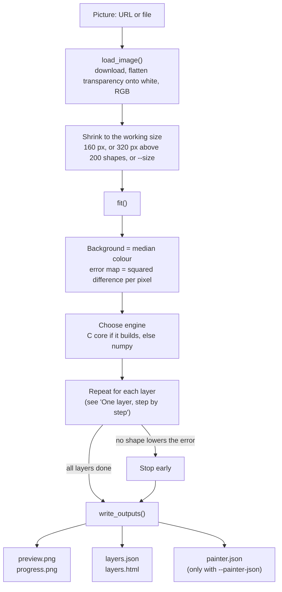
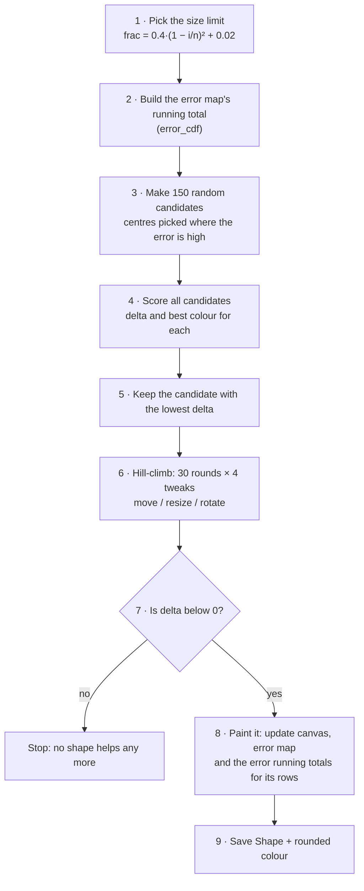

# Architecture

How `fh6_sticker.py` turns a picture into Forza Horizon 6 vinyl layers, and exactly what happens
when it adds one layer.

## The repository at a glance

| Path | What it is |
|------|------------|
| [`fh6_sticker.py`](fh6_sticker.py) | The sticker maker: loads a picture, fits shapes to it, writes the layer sheet. Everything below is about this file. |
| [`fh6_fastcore.c`](fh6_fastcore.c) | Optional C version of the two hot loops (scoring shapes and hill-climbing). Built automatically on first use. |
| [`tests/test_fh6_sticker.py`](tests/test_fh6_sticker.py) | Tests for the fitter, the C core and the forza-painter export. |
| [`painter/`](painter/) | A separate, bundled Windows app ([forza-painter FH6](painter/README.md)) that writes layers straight into the game. `fh6_sticker.py --painter-json` produces a file it can import. Its own GPU generator lives in [`painter/generator/`](painter/generator/). |

## The whole program



1. **Load** ([`load_image`](fh6_sticker.py)). URLs are downloaded. Transparent pictures are laid on white, then
   converted to plain RGB.
2. **Shrink** to the working size with a high-quality (Lanczos) resize. Every later step runs at this size,
   so it sets the speed/detail trade-off.
3. **Fit** ([`fit`](fh6_sticker.py)). Start from a canvas filled with the picture's median colour, then add
   one opaque shape at a time. Each one is the best shape found for that step: the one that lowers the
   total error the most. Error is the squared colour difference between the canvas and the picture, summed
   over all pixels.
4. **Write outputs** ([`write_outputs`](fh6_sticker.py), [`write_painter_json`](fh6_sticker.py)).
   Layer 1 in the sheet is always a background rectangle; fitted shapes follow as layers 2, 3, and so on.
   Positions and sizes are converted to percentages of the sticker's longest side
   ([`to_game_units`](fh6_sticker.py)) so you can scale them to any size in-game.

## How a shape is stored

During fitting, a shape is one row of 6 numbers, and a batch of shapes is a `(B, 6)` array:

| Column | Meaning |
|--------|---------|
| `cx, cy` | centre, in working-image pixels (y down) |
| `w, h` | full width and height |
| `rot` | rotation in degrees, 0–180 |
| `is_circle` | 1 for an ellipse (the game's Circle), 0 for a rectangle (Square) |

After a layer is chosen, it becomes a `Shape` object (kind, centre, size, rotation) plus an RGB colour. The
output functions only see those objects.

## How shapes are scored (the fast part)

Scoring a shape answers one question: *if this shape were painted next, in its best colour, how much would
the total error change?* That number is the shape's **delta**. Negative is good.

**Row runs.** Circles and rectangles are convex, so on any pixel row a shape covers one unbroken run
`[x0, x1)`. [`shape_spans`](fh6_sticker.py) works out each run directly from the geometry:

- a pixel belongs to a shape when its **centre** is inside it;
- for an ellipse, "inside" on a fixed row is a quadratic in x, so the run's ends are the quadratic's two roots;
- for a rotated rectangle, it is two "between these bounds" conditions that are straight lines in x; the run is
  where both hold.

**Running totals.** [`_Scorer`](fh6_sticker.py) keeps three tables, each a running total along every row:

| Table | Running total of |
|-------|------------------|
| `ct` | the picture's colour (R, G, B) |
| `cq` | the picture's squared colour, summed over R, G, B |
| `ce` | the current error map |

The sum of anything over a run is then just `table[row, x1] − table[row, x0]`: two lookups per row,
however wide the run. Adding up all of a shape's rows gives:

- `n`: pixels covered
- `S`: their colour sum
- `Q`: their squared-colour sum
- `E`: their current error

From those:

```
best colour = S / n                          (the mean colour under the shape)
delta       = (Q − |S|² / n)  −  E
              new error with     error there
              that colour        right now
```

Shapes covering fewer than 2 pixels get `delta = ∞`, so they are never picked.

**Two engines, same maths.**

| | numpy (`_NumpySearch`) | C (`_CSearch`, [`fh6_fastcore.c`](fh6_fastcore.c)) |
|---|---|---|
| Scoring | whole batches in a few array operations; candidates grouped 32 at a time by height so each group only reads nearby rows | one shape at a time, only the rows that shape can reach |
| Hill-climb | one numpy call per round | the whole climb in one C call, with its own random generator seeded from numpy (so `--seed` still works) |
| When used | always available | when a C compiler can build it (`--engine auto`, the default) |

[`load_fastcore`](fh6_sticker.py) builds the C file once with `cc`, `gcc`, `clang` or `$CC`. It caches the
library in `__pycache__` (or the temp folder), named by a hash of the C source, so editing the C file triggers
a rebuild. If building fails, the program uses numpy without complaint; `--engine c` makes it an error instead.

## One layer, step by step

The loop body in [`fit`](fh6_sticker.py) runs once per layer. The numbers in the right-hand column come from a real
run. The picture is a red circle beside a navy rectangle on white, the working image is 160×120,
60 layers were asked for, and `--seed 1` with the C engine. This is **layer 2**; layer 1 had already put a dark
purple rectangle over the navy block.



| Step | What happens | Code | Example (layer 2) |
|------|--------------|------|-------------------|
| 1. Size limit | Shapes start big and shrink as the picture fills in. Width and height are drawn from 1.5 px up to `longest side × frac` (at least 3 px). | `fit` | `frac = 0.407`, so sizes up to 65.1 px |
| 2. Error lookup | Running total of the error map, flattened, so a pixel can be picked with probability proportional to its error. Built once per layer; the map only changes when a layer is added. Layer 1 skips this and places centres uniformly. | `error_cdf` | — |
| 3. Candidates | 150 shapes (`--quality`): for each centre, draw a random number up to the total error and binary-search the running total (plus a random offset inside that pixel); then random width, height, rotation and kind (from `--kinds`). | `random_shapes` | 150 candidates |
| 4. Score | Row runs → running-total lookups → `delta` and mean colour for every candidate. | `_CSearch.score` / `fc_score`, or `_Scorer.score_many` | 144 of 150 would lower the error |
| 5. Best candidate | Lowest delta wins. | `np.argmin` | ellipse at (44, 58), 63×58, 135°, colour (252, 24, 26), delta −308,047,027 |
| 6. Hill-climb | 30 rounds (`climbs // CLIMB_BATCH`): make 4 copies, give each one random tweak (move the centre, change width, change height, or rotate), score them, and keep the best if it lowers the delta. The C climb also keeps *equal* scores, so the shape can drift across tweaks that cover the same pixels instead of stopping at the first flat spot. | `_CSearch.climb` / `fc_climb`, or `_NumpySearch.climb` + `mutate` | ellipse at (50, 57), 74×61, 91°, colour (255, 22, 22), delta −392,675,317 |
| 7. Check | If even the best shape doesn't lower the error, stop adding layers. | `fit` | −392,675,317 < 0, so continue |
| 8. Paint | Draw its exact pixel mask from the same row runs. Fill those canvas pixels with the colour, recompute the error there, and rebuild the `ce` running totals for only the rows it touched. | `shape_mask`, `_Scorer.refresh_rows` | 4,541 pixels on 75 rows; total error 498,147,888 → 105,472,571 (exactly the predicted delta), RMSE 93.0 → 42.8 |
| 9. Record | Store it as a `Shape` with the colour rounded to whole numbers. Every 10 layers (every 50 above 200 layers), log the current error. | `to_shape` | in the sheet: Circle, #FF1616, x −18.97, y 1.62, width 46.41, height 38.15, rotation 90.6° |

The cost of one layer is about 270 shape scores (150 candidates + 30 × 4 climb tweaks). Thanks to the running
totals, each score costs one lookup pair per row the shape covers, not one per pixel. That is why 1,000 layers at
320 px take about a second with the C core.

## Outputs

| File | Made by | Notes |
|------|---------|-------|
| `preview.png` | `render` | Draws every layer with Pillow at about 640 px. Ellipses are drawn as 48-sided polygons, so the edges can differ by a pixel from what the fitter scored. |
| `progress.png` | `render` | The picture after 10%, 25%, 50% and 100% of the layers, side by side. |
| `layers.json` | `write_outputs` | Every layer's shape, hex colour, position, size and rotation in game units: % of the longest side, x right, y up, rotation clockwise. |
| `layers.html` | `write_outputs` | The same as a printable sheet with tick boxes and the preview image. |
| `painter.json` | `write_painter_json` | Only with `--painter-json`, which forces ellipses only. Format for forza-painter's "Import JSON": shape 0 is the background rectangle (type 1); ellipses are type 16 with `[cx, cy, radius_x, radius_y, rotation]`. Coordinates are scaled up to the original picture's longest side, capped at 1,400 px. |

## Knobs that change the fit

| Setting | Where | Effect |
|---------|-------|--------|
| `--shapes` | CLI | Number of layers. Above 200, the default working size goes to 320 px. |
| `--size` | CLI | Working resolution. Scoring cost grows with the height of each shape in pixels. |
| `--quality` | CLI → `candidates` | Random candidates per layer (default 150). |
| `--kinds` | CLI | `circle`, `square` or both. |
| `--engine` | CLI | `auto`, `c` or `numpy`. |
| `--seed` | CLI | Seeds numpy's random generator, which also seeds the C climb, so a run repeats exactly on the same engine. |
| `climbs` | `fit` argument | Hill-climb tweaks per layer (default 120 = 30 rounds × `CLIMB_BATCH`). |
| `CLIMB_BATCH`, `SCORE_CHUNK` | module constants | Tweaks tried per climb round (4) and the numpy scoring group size (32). |
